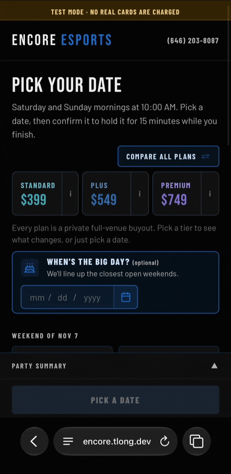
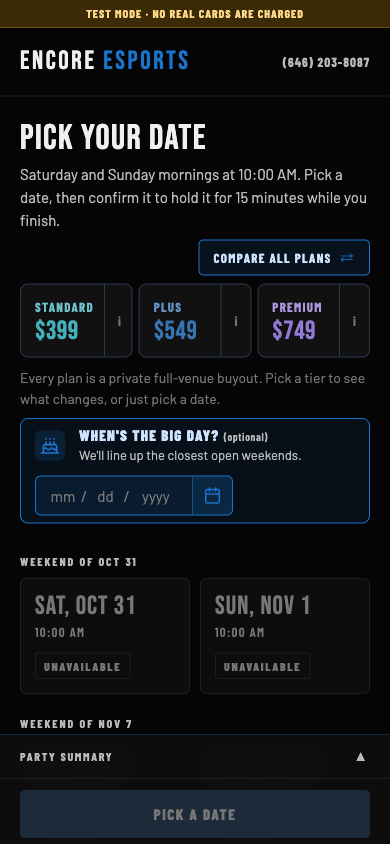

# Encore Party Booking

[](https://github.com/tlonglol/encore-booking/actions/workflows/tests.yml)

A self-serve booking and deposit system for [Encore Esports](https://encoregaming.us), a gaming venue in New Rochelle, NY. A parent picks a weekend morning, sees a live server-computed price, and pays a $100 deposit that locks the date instantly: no phone call, no human in the loop.

Built to replace a contact form that produced leads the owner had to chase by hand.

**[Try it →](https://encore.tlong.dev)** · Square sandbox, no real cards are charged. Test card `4111 1111 1111 1111`, any future expiry, any CVV, any ZIP.

<!-- Demo GIF goes here: <p align="center"></p> -->

<p align="center">
  
  &nbsp;
  
</p>

---

## What it does

A parent moves through four steps (**date → extras → info + deposit → confirmation**) in about three taps. Along the way the system holds the slot for 15 minutes, prices the party server-side, takes a card without ever leaving the page, and texts both the parent and the owner the moment the money lands.

After booking, a tokenized link (no login) lets the parent add packs, reschedule, or cancel. Cancellations more than 7 days out refund the deposit through Square automatically.

An admin page shows the owner bookings, cancellations and notification history, and a demo reset puts the sandbox data back to a known state between walkthroughs.

## The parts worth reading

This is a small system, but the money path is where the care went.

**Slot exclusivity is a database constraint, not a check.** Two parents tapping the same Saturday at the same instant is the failure that matters, and `if slot_is_free(): create_hold()` does not survive it. A Postgres partial unique index (`holds_one_active_per_slot`) makes the second insert fail, and the API turns that into a 409. [`test_concurrent_holds`](tests/test_concurrent_holds.py) fires N real parallel connections at one slot and asserts exactly one wins.

**The webhook is the backstop, not the booking.** The deposit is charged synchronously so the parent sees a confirmation code immediately, and Square's webhook arrives behind it as insurance. Either can commit the booking; both converge on one. The handler verifies Square's HMAC against the **raw body before parsing**, processes only `COMPLETED` payments, re-checks the amount against the hold's own snapshot, and is idempotent at both the event id and the payment id. [`test_pay.py`](tests/test_pay.py) runs both orderings (pay-then-webhook and webhook-then-pay) and asserts one booking, one payment, one notification set.

**The booking commits before any notification is attempted.** Twilio being down is not a reason to lose a party. Notifications are best-effort and logged; they never fail the webhook or roll back a booking.

**The client never sends a price.** One `quote()` function prices everything, server-side, and the total is snapshotted onto the hold. A later price change cannot move a booking that already exists.

**Nothing is swept.** There is no cron, no queue, no background worker. A hold expires because the request that asks about it evaluates the database clock. That is what makes the system correct on a platform that freezes the container between invocations: a hold that lapsed while nothing was running is still lapsed when someone finally looks.

**Time is handled by the timezone library, not by hand.** Slots are defined in `America/New_York` and stored as `timestamptz`; the same weekend morning is 14:00Z in summer and 15:00Z in winter. Money is integer cents throughout.

## Architecture

```
Browser ──> API Gateway (HTTP API) ──> Lambda (FastAPI + Mangum) ──> Neon Postgres
                                            │
                                            ├──> Square  (Web Payments SDK + Payments API + webhooks)
                                            └──> Twilio / SMTP / Discord   (best-effort)
```

One Lambda serves the API, the static frontend, and the `/book/*` SPA catch-all: **one origin, no CDN**. That was deliberate: the admin page authenticates with a cookie that a split deploy would make third-party (Safari blocks those outright), and putting CloudFront in front of everything would hide the real client IP that the abuse caps are built on. The whole system is one `terraform apply`.

The frontend is vanilla HTML/CSS/JS with no build step, themed to match the live venue site.

## Tests

**401 tests across 36 files**, all against real Postgres, never SQLite, because the partial unique index and the concurrent-transaction behavior under test *are* Postgres behavior.

```bash
docker compose up -d db
pytest
```

They run with no network access to Square or Twilio: webhook bodies are replayed with a real signature computed from a test key, and the notification layer falls back to logging. The concurrency and idempotency tests were written alongside their features, not bolted on after.

## Running it locally

Requires Python 3.12 and Docker.

```bash
python -m venv .venv && source .venv/bin/activate
pip install -r requirements.txt
cp .env.example .env          # sandbox credentials; see the comments in that file
docker compose up -d db
alembic upgrade head
uvicorn app.main:app --reload
```

Square webhooks in development arrive through an ngrok static domain set as `SQUARE_WEBHOOK_NOTIFICATION_URL`.

Deploying is `scripts/build_lambda.sh` then `terraform apply` in `infra/`, with migrations run from a laptop against Neon's direct connection string (the Lambda uses the pooled one and does not ship `alembic/`).

## Scope

Demo v1, defined in [SPEC.md](SPEC.md). Sandbox Square credentials only. Deliberately out of scope: online balance collection, memberships, staff accounts, calendar sync, and any kind of scheduled job.

## Stack

FastAPI · SQLAlchemy 2 + Alembic (12 migrations) · Postgres (Neon) · Square Web Payments SDK · Twilio · Terraform · AWS Lambda + API Gateway · vanilla JS
